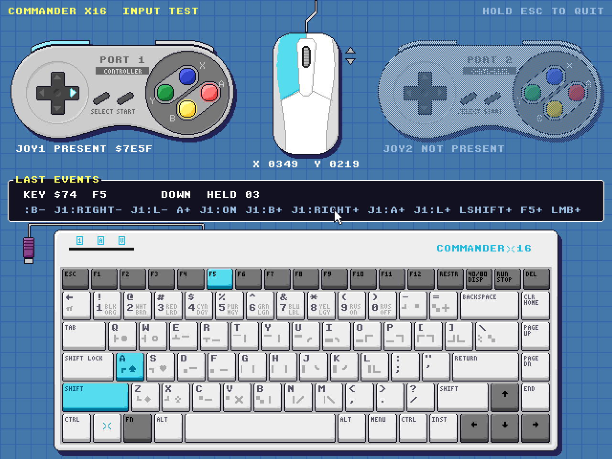

# CX16-INPUT-TEST


[](https://github.com/ifilot/cx16-input-test/actions/workflows/build.yml)
[](https://www.gnu.org/licenses/gpl-3.0)

[Download latest version](https://github.com/ifilot/cx16-input-test/releases/latest/download/CX16-INPUT-TEST.ZIP)



## Description

A hardware tester for the Commander X16's input devices: the keyboard, the PS/2
mouse and the SNES controllers on ports 1 and 2. Each device is drawn after the
original hardware. Every key, mouse button and controller button lights up while
it is held, and a panel logs the last events.

* **Keyboard**: the full Commander X16 keyboard layout, with PETSCII graphics and
  colour codes on the keycaps. All keys report press and release, including the
  modifiers. SHIFT LOCK and 40/80 (scroll lock) toggle the lock LEDs on screen and
  on the keyboard. The panel shows the keynum, the key name and how many keys are
  held.
* **Mouse**: left, right and middle buttons, wheel up and down indicators, and the
  pointer position.
* **SNES controllers**: all 12 buttons on both ports, the raw `joystick_get` bytes,
  and a dimmed controller when no pad is plugged in.

Hold **ESC** for 1.5 seconds to quit. The progress shows in the top-right
corner, and the program returns to a clean BASIC screen.

## Building

Requirements: [cc65](https://cc65.github.io/) (2.19 or newer), GNU make, zip, and
Python 3 with Pillow, NumPy and SciPy.

```
make              # assets + build/X16INPUT.PRG
make run          # run in ../x16-emulator/build/x16emu
make dist         # build/CX16-INPUT-TEST.ZIP
make test-assets  # asset round-trip test (no emulator needed)
make test         # asset test + emulator test (AgentBridge)
make mockup       # design/mockups/screen.png
make font         # refresh assets/font from ../emulator/rom.bin
```

`assets/font/x16-charset.bin` holds the PETSCII and ISO 8x8 character sets from
the Commander X16 ROM (bank 6), so the build does not need a ROM.

## Releases

The version lives in `VERSION`. GitHub Actions builds and checks every push and
pull request. Pushing a tag that matches it (e.g. `v0.1.0`) also publishes
`CX16-INPUT-TEST.ZIP` as a GitHub release.

On Windows, `run.bat` builds through WSL and starts `..\emulator\x16emu.exe`.

To run on real hardware, unpack `CX16-INPUT-TEST.ZIP` (or copy `X16INPUT.PRG` and
the six `*.BIN` files from `build/`) into one folder on the SD card.

## How it works

The screen is 640x480 in 4bpp tile mode. A 16-colour bitmap at that resolution
would need 150 KB, more than VERA's 128 KB of video memory. Layer 0 holds the
controllers, the mouse and the event panel; layer 1 holds the keyboard plus a
transparent text overlay. The mouse pointer is sprite 0.

All artwork is drawn procedurally in `tools/art.py`. `tools/build_assets.py`
renders the idle screen and, for each input, the screen with only that input
held, and diffs the two:

* Keyboard keys light up by **palette swapping**: one global recolour table turns
  each idle colour into its lit colour. Pressing a key only changes the palette
  bits of its map entries.
* Everything else **swaps whole tiles** for pre-rendered pressed versions, so
  these inputs keep their own look (glowing face buttons, lit d-pad arrows).
* The 17 top-row keys sit at a 30-pixel pitch, which does not line up with the
  8-pixel tile grid. The 18 tiles that two neighbouring keys share get four
  pre-rendered states each.

The palette packing fits in 14 of VERA's 16 palette rows. `tests/test_assets.py`
decodes the generated files with a small software VERA and checks them
pixel-exact against the art. `tests/test_emulator.py` drives the real program in
x16emu and checks start-up, every emulated key, the LEDs, the mouse, a simulated
controller and quitting.

## Notes

* **FN** is handled inside the keyboard and never reaches the computer, so it
  never lights up.
* **RESTORE** sends keynum 124 (Print Screen). x16emu cannot send this key, so it
  is only testable on real hardware. CTRL+ALT+RESTORE still warm-starts the
  machine, as always.
* **40/80 DISPLAY** is assumed to send Scroll Lock (keynum 125). This needs to be
  confirmed on real hardware.
* cc65 2.19's `waitvsync()` polls the pre-R39 RAM bank register and hangs on
  current ROMs. The program waits on the KERNAL jiffy clock instead.
